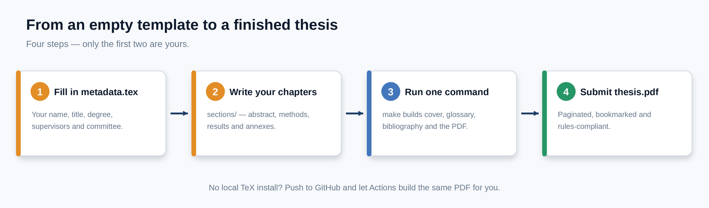
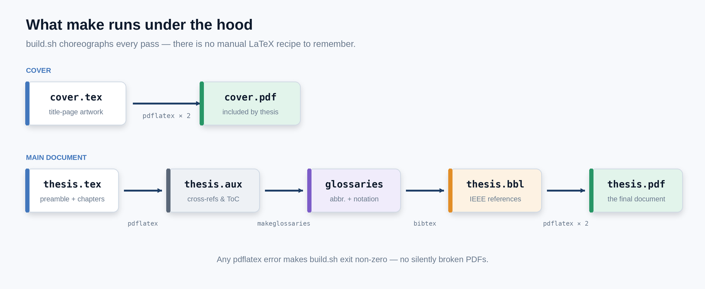
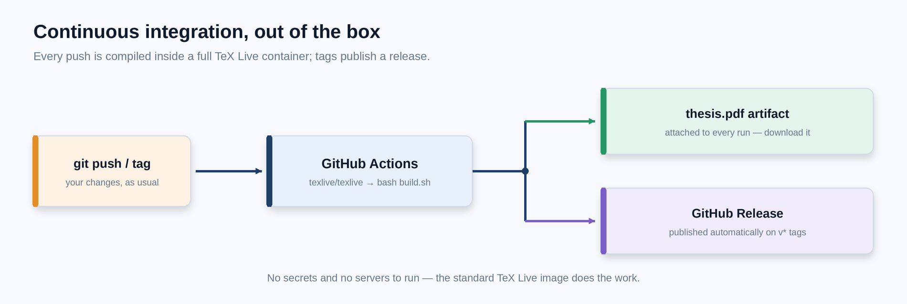
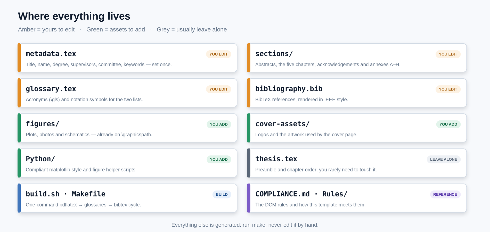

<p align="center">
  
</p>

<p align="center">
  <a href="https://github.com/JPMarcelino/MIEMN_thesis_template/actions/workflows/build.yml"></a>
  <a href="LICENSE"></a>
  
  
  
  <a href="https://github.com/JPMarcelino/MIEMN_thesis_template/issues"></a>
</p>

<p align="center">
  A ready-to-write, <b>rules-compliant LaTeX template</b> for the Master's dissertation of the<br>
  <b>Integrated Master in Micro and Nanotechnology Engineering (MIEMN)</b> at NOVA FCT.
</p>

<p align="center">
  <a href="#why-this-template">Why this template</a> ·
  <a href="#see-the-output">See the output</a> ·
  <a href="#how-it-works">How it works</a> ·
  <a href="#quick-start">Quick start</a> ·
  <a href="#what-to-edit">What to edit</a> ·
  <a href="#writing">Writing</a> ·
  <a href="COMPLIANCE.md">Compliance</a>
</p>

---

Fill in **one file** ([`metadata.tex`](metadata.tex)), write your chapters in [`sections/`](sections),
and get a properly formatted PDF — title page, bilingual abstract, copyright page,
lists of abbreviations/notation/figures/tables, IEEE bibliography and lettered
annexes — plus a **live build on GitHub Actions**. You never fight the formatting
rules again; they are baked into the template.

## Why this template

<table>
<tr>
<td width="33%" valign="top">
<b>One place for your details</b><br><br>
Title, name, degree and supervisors are defined once in <code>metadata.tex</code> and reused by the title page, the cover and the PDF metadata.
</td>
<td width="33%" valign="top">
<b>Rules built in</b><br><br>
2 cm margins, Times New Roman 11 pt, 1.25 line spacing, numbered floats, IEC/ISO units via <code>siunitx</code>, IEEE references — all matching the DCM rules.
</td>
<td width="33%" valign="top">
<b>Compliant figures by default</b><br><br>
A matplotlib style (<code>Python/miemn.mplstyle</code>) produces plots with Arial 28 pt ticks and 31 pt axis labels, exactly as the rules require.
</td>
</tr>
<tr>
<td width="33%" valign="top">
<b>Beautiful typography</b><br><br>
Times, hyperlinked cross-references (<code>\cref</code>), <code>booktabs</code> tables, clickable bookmarks and a clean TikZ cover.
</td>
<td width="33%" valign="top">
<b>One-command build</b><br><br>
<code>make</code> runs the full <code>pdflatex → makeglossaries → bibtex → pdflatex ×2</code> cycle and fails loudly on errors.
</td>
<td width="33%" valign="top">
<b>Continuous integration</b><br><br>
Every push and pull request builds the PDF and uploads it as an artifact; tags publish a release.
</td>
</tr>
</table>

## See the output

Every page below is produced by the template. The body text is placeholder
content — replace it with your own.

<p align="center">
  
  <br>
  <sub><b>All 29 pages</b> of the sample document, compiled by <code>make</code>.</sub>
</p>

<table align="center">
  <tr>
    <td align="center" valign="top">
      <a href="docs/assets/pages/title.png"></a><br>
      <sub><b>Title page</b><br>driven entirely by <code>metadata.tex</code></sub>
    </td>
    <td align="center" valign="top">
      <a href="docs/assets/pages/contents.png"></a><br>
      <sub><b>Contents</b><br>auto-generated, with hyperlinks</sub>
    </td>
    <td align="center" valign="top">
      <a href="docs/assets/pages/introduction.png"></a><br>
      <sub><b>Chapter opener</b><br>numbered headings and running head</sub>
    </td>
  </tr>
  <tr>
    <td align="center" valign="top">
      <a href="docs/assets/pages/table.png"></a><br>
      <sub><b>Tables</b><br><code>booktabs</code> + <code>siunitx</code> units</sub>
    </td>
    <td align="center" valign="top">
      <a href="docs/assets/pages/abbreviations.png"></a><br>
      <sub><b>Abbreviations &amp; notation</b><br>glossary + xindy, in the ToC</sub>
    </td>
    <td align="center" valign="top">
      <a href="docs/assets/pages/bibliography.png"></a><br>
      <sub><b>Bibliography</b><br>IEEE style via <code>natbib</code></sub>
    </td>
  </tr>
</table>

## How it works

### Your workflow

Edit two things, run one command, get a submission-ready PDF.

<p align="center">
  
</p>

### What `make` does under the hood

`build.sh` is the canonical recipe — no manual LaTeX incantations to remember.

<p align="center">
  
</p>

### Continuous integration, out of the box

No servers or secrets: the standard TeX Live image does the work.

<p align="center">
  
</p>

## Quick start

<table>
<tr>
<td width="50%" valign="top">
<b>Overleaf</b><br><br>
<ol>
<li>Upload this repository (or <i>New Project → Import from GitHub</i>).</li>
<li>Set the main document to <code>thesis.tex</code>.</li>
<li>Edit <code>metadata.tex</code> and the files in <code>sections/</code>.</li>
</ol>
Overleaf has xindy and <code>makeglossaries</code>, so the abbreviation and notation lists build automatically once you enable the glossary step.
</td>
<td width="50%" valign="top">
<b>GitHub Actions</b><br><br>
No setup needed: pushing to <code>main</code> builds <code>thesis.pdf</code> and attaches it to the workflow run. Push a tag like <code>v1.0</code> to publish a release with the PDF.
</td>
</tr>
</table>

**Local build** — install a full TeX Live distribution (or MiKTeX/MacTeX);
xindy and `makeglossaries` are required for the glossary.

```bash
git clone https://github.com/JPMarcelino/MIEMN_thesis_template.git
cd MIEMN_thesis_template

make            # full build -> thesis.pdf
make cover      # rebuild just the cover
make check      # build + page-budget report
make clean      # remove auxiliary files
```

`make` calls [`build.sh`](build.sh), which is the canonical recipe. Plain
`latexmk -pdf thesis` also works via the bundled [`.latexmkrc`](.latexmkrc).

## What to edit

<p align="center">
  
</p>

| File | What it is for |
| --- | --- |
| [`metadata.tex`](metadata.tex) | **Start here.** Title, author, degree, supervisors, committee, university, date, keywords. |
| [`sections/abstract.tex`](sections/abstract.tex) | English abstract (Summary, ~300 words). |
| [`sections/resumo.tex`](sections/resumo.tex) | Portuguese abstract. |
| [`sections/acknowledgements.tex`](sections/acknowledgements.tex) | Acknowledgements. |
| [`sections/introduction.tex`](sections/introduction.tex) | Chapter 1 — Introduction. |
| [`sections/stateoftheart.tex`](sections/stateoftheart.tex) | Chapter 2 — State of the Art. |
| [`sections/methods.tex`](sections/methods.tex) | Chapter 3 — Materials and Methods. |
| [`sections/results.tex`](sections/results.tex) | Chapter 4 — Results and Discussion. |
| [`sections/conclusions.tex`](sections/conclusions.tex) | Chapter 5 — Conclusions and Future Perspectives. |
| [`glossary.tex`](glossary.tex) | Acronyms and notation. |
| [`bibliography.bib`](bibliography.bib) | Your references (BibTeX). |
| [`sections/appendix_*.tex`](sections) | Annexes A–H. Delete the ones you do not use. |
| [`figures/`](figures), [`cover-assets/`](cover-assets) | Images and cover artwork. |

You should never need to edit `thesis.tex` except to add, remove or reorder chapters.

<details>
<summary><b>Wiring your data in</b></summary>

`metadata.tex` defines simple commands that the rest of the document consumes:

```latex
\newcommand*{\thesistitle}{Full Title of Your Thesis}
\newcommand*{\thesisauthor}{Your Full Name}
\newcommand*{\thesisdegree}{Master of Science}
\newcommand*{\thesisprogram}{Micro and Nanotechnology Engineering}
\newcommand*{\thesisuniversity}{NOVA University Lisbon}
\newcommand*{\thesissupervisors}{Supervisor One, Supervisor Two}
```

</details>

## Writing

<details>
<summary><b>Figures</b> — include images and generate rules-compliant plots</summary>

Put images in `figures/` (subfolders are fine) and include them with a path
relative to that folder — `\graphicspath` is already set:

```latex
\begin{figure}[htbp]
  \centering
  \includegraphics[width=0.8\textwidth]{my-plot.pdf}
  \caption{Device response as a function of bias.}
  \label{fig:response}
\end{figure}
```

Reference it with `\cref{fig:response}` (self-updating “Figure 4.2”, with a hyperlink).

Generate compliant plots with the bundled style:

```python
import sys; sys.path.insert(0, "Python")
import matplotlib.pyplot as plt, figure_style
figure_style.use_thesis_style()
# ... draw ...
figure_style.save_figure(fig, "figures/Python/my-plot")
```

</details>

<details>
<summary><b>Tables</b> — publication quality with <code>booktabs</code> + <code>siunitx</code></summary>

```latex
\begin{table}[htbp]
  \centering
  \caption{Measured performance.}
  \label{tab:performance}
  \begin{tabular}{l S[table-format=2.1]}
    \toprule
    Parameter & {Value (\si{\micro\second})} \\
    \midrule
    Rise time & 3.4 \\
    Fall time & 2.1 \\
    \bottomrule
  \end{tabular}
\end{table}
```

</details>

<details>
<summary><b>Equations, references and acronyms</b></summary>

```latex
\begin{equation}
  \label{eq:rc}
  \tau = R\,C
\end{equation}

As shown in \cref{eq:rc} \cite{smith2020example}, ...
The \gls{serdes} block ...
```

</details>

## Compliance

The rules cap the written content at **33 pages**. `make check` prints how many
pages each chapter currently takes and flags anything over budget. The full
rule-by-rule breakdown lives in [`COMPLIANCE.md`](COMPLIANCE.md).

| Section | Maximum |
| --- | --- |
| Motivation | 1 page |
| Summary (abstract) | 300 words (FCT-UNL) |
| Introduction | 5 pages |
| Materials and Methods | 2 pages (6 in industrial theses) |
| Results and Discussion | 20 pages |
| Conclusions and Future Perspectives | 2 pages |
| References | 2 pages |
| **Total written content** | **33 pages** |

## Requirements

- A full TeX Live 2023+ (or MiKTeX/MacTeX) with `pdflatex`, `bibtex`,
  `makeglossaries` and **xindy** (for the glossary).
- Python 3 only if you use the figure helpers or the page-budget report.

## Troubleshooting

<details>
<summary><b>Glossary lists are empty</b></summary>

Run `makeglossaries thesis` (or just run `make`, which does it for you). xindy must be installed.

</details>

<details>
<summary><b>Bibliography is empty</b></summary>

Run `bibtex thesis` between pdflatex passes, or use `make`. Check that your `\cite` keys exist in `bibliography.bib`.

</details>

<details>
<summary><b>“File <code>cover.pdf</code> not found”</b></summary>

Run `make cover` first; the main document warns but still builds without it.

</details>

<details>
<summary><b>Overfull boxes</b></summary>

Usually harmless; enable `\usepackage{showframe}` in `thesis.tex` temporarily to see the text block.

</details>

## Contributing

Issues and pull requests are welcome. Please keep the template compiling
cleanly (`make`) and keep personal data out of the committed files.

## License

[MIT](LICENSE) © João Paulo Marcelino.
