<p align="center">
  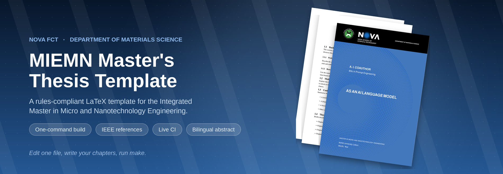
</p>

<p align="center">
  <a href="https://github.com/JPMarcelino/MIEMN_thesis_template/actions/workflows/build.yml"></a>
  <a href="LICENSE"></a>
  
  
  <a href="https://github.com/JPMarcelino/MIEMN_thesis_template/issues"></a>
</p>

<p align="center">
  A LaTeX template for the master's dissertation of the Integrated Master in<br>
  Micro and Nanotechnology Engineering (MIEMN) at NOVA FCT.
</p>

<p align="center">
  <a href="#overview">Overview</a> ·
  <a href="#the-pages">The pages</a> ·
  <a href="#how-it-works">How it works</a> ·
  <a href="#getting-started">Getting started</a> ·
  <a href="#files">Files</a> ·
  <a href="#writing">Writing</a> ·
  <a href="#page-limit">Page limit</a>
</p>

---

Fill in [`metadata.tex`](metadata.tex), write the chapters in [`sections/`](sections),
and run `make`. The files in `sections/` ship with placeholder text, so replace it
before you submit.

## Overview

- Times New Roman 11 pt, 1.25 line spacing, 2 cm margins on every side.
- A cover, a title page, both abstracts, a copyright page, and lists of
  abbreviations, notation, figures and tables.
- Numbered figures, tables and equations, cross-referenced with `\cref`.
- An IEEE bibliography and lettered annexes.

## The pages

Every page below is produced by the template.

<p align="center">
  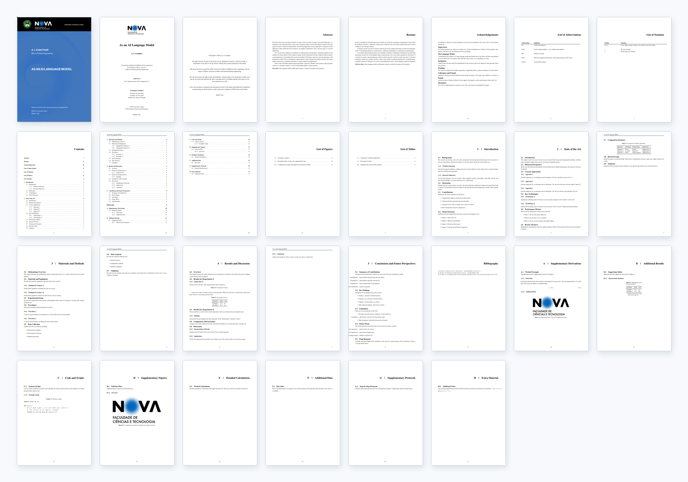
  <br>
  <sub>The 29 pages of the sample document, built by <code>make</code>.</sub>
</p>

<table align="center">
  <tr>
    <td align="center" valign="top">
      <a href="docs/assets/pages/title.png">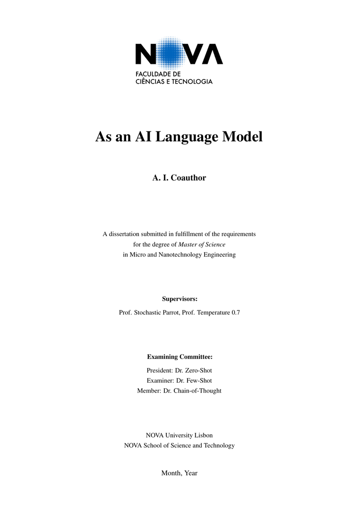</a><br>
      <sub><b>Title page</b></sub>
    </td>
    <td align="center" valign="top">
      <a href="docs/assets/pages/contents.png">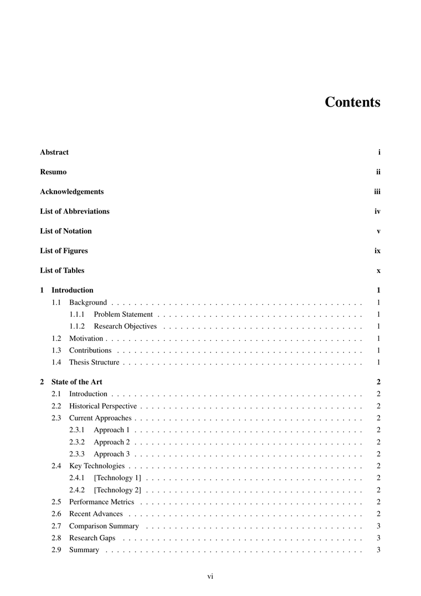</a><br>
      <sub><b>Contents</b></sub>
    </td>
    <td align="center" valign="top">
      <a href="docs/assets/pages/introduction.png">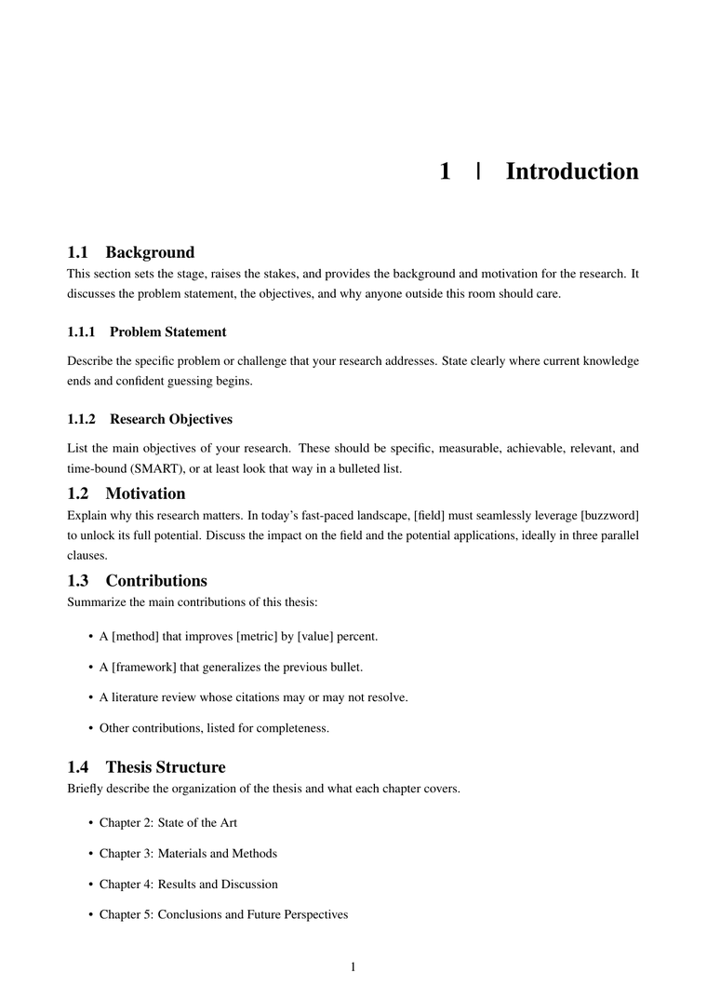</a><br>
      <sub><b>A chapter</b></sub>
    </td>
  </tr>
  <tr>
    <td align="center" valign="top">
      <a href="docs/assets/pages/table.png">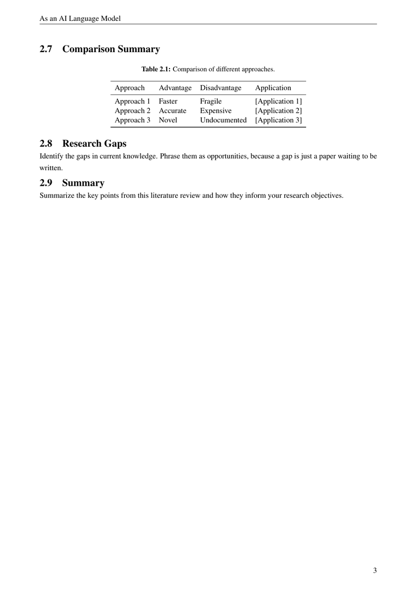</a><br>
      <sub><b>A table</b></sub>
    </td>
    <td align="center" valign="top">
      <a href="docs/assets/pages/abbreviations.png">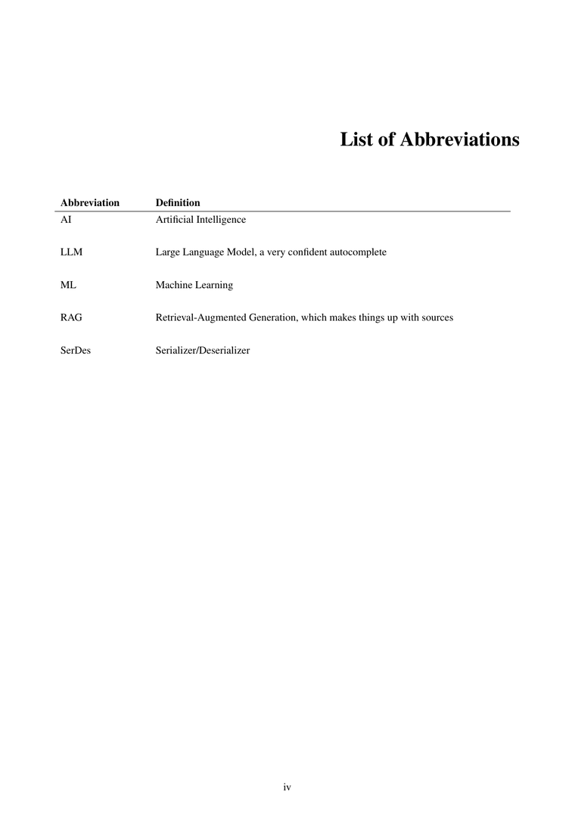</a><br>
      <sub><b>Abbreviations</b></sub>
    </td>
    <td align="center" valign="top">
      <a href="docs/assets/pages/bibliography.png">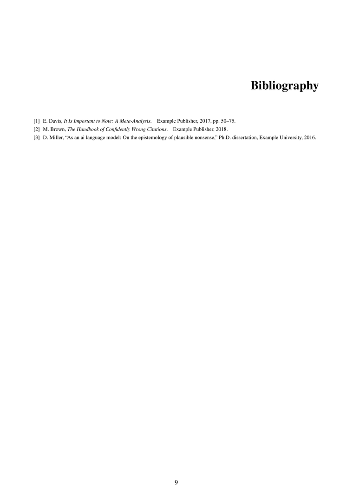</a><br>
      <sub><b>Bibliography</b></sub>
    </td>
  </tr>
</table>

## How it works

<p align="center">
  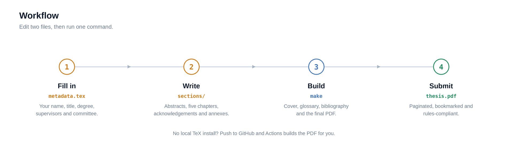
</p>

<p align="center">
  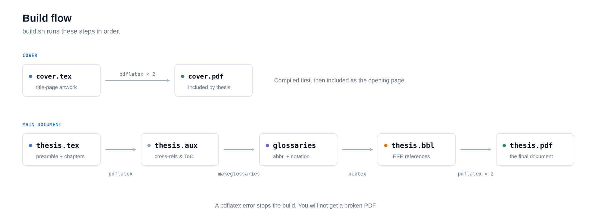
</p>

<p align="center">
  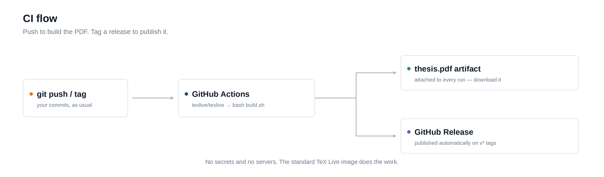
</p>

## Getting started

On Overleaf, upload the repository or import it from GitHub, set `thesis.tex` as the
main document, then edit `metadata.tex` and `sections/`. Overleaf has xindy and
`makeglossaries`, so the abbreviation and notation lists build on their own.

Locally, install a full TeX Live, MiKTeX or MacTeX.

```bash
git clone https://github.com/JPMarcelino/MIEMN_thesis_template.git
cd MIEMN_thesis_template

make            # full build, writes thesis.pdf
make cover      # rebuild just the cover
make check      # build, then print the page counts
make clean      # remove the auxiliary files
```

`make` calls [`build.sh`](build.sh). `latexmk -pdf thesis` also works, using the
bundled [`.latexmkrc`](.latexmkrc).

## Files

<p align="center">
  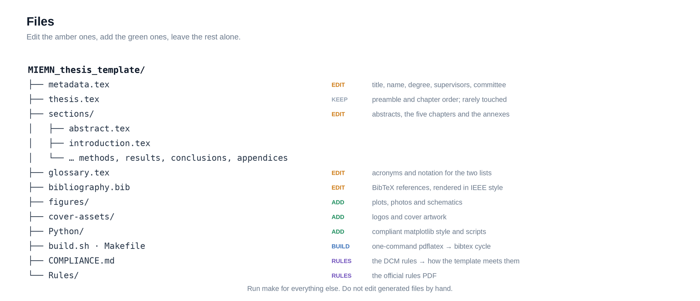
</p>

Edit [`metadata.tex`](metadata.tex) and [`sections/`](sections). Put images in
[`figures/`](figures) and references in [`bibliography.bib`](bibliography.bib).
Annexes A to H live in [`sections/appendix_*.tex`](sections); delete the ones you do
not use and remove the matching line in `thesis.tex`.

## Writing

<details>
<summary><b>Figures</b></summary>

Put images in [`figures/`](figures); `\graphicspath` already points there.

```latex
\begin{figure}[htbp]
  \centering
  \includegraphics[width=0.8\textwidth]{my-plot.pdf}
  \caption{Device response as a function of bias.}
  \label{fig:response}
\end{figure}
```

Reference figures with `\cref{fig:response}`. For plots, use the bundled style so the
fonts and units match the rules.

```python
import sys; sys.path.insert(0, "Python")
import matplotlib.pyplot as plt, figure_style
figure_style.use_thesis_style()
# draw something
figure_style.save_figure(fig, "figures/Python/my-plot")
```

</details>

<details>
<summary><b>Tables</b></summary>

```latex
\begin{table}[htbp]
  \centering
  \caption{Measured performance.}
  \label{tab:performance}
  \begin{tabular}{l S[table-format=2.1]}
    \toprule
    Parameter & {Value (\si{\micro\second})} \\
    \midrule
    Rise time & 3.4 \\
    Fall time & 2.1 \\
    \bottomrule
  \end{tabular}
\end{table}
```

</details>

<details>
<summary><b>Equations, references and acronyms</b></summary>

```latex
\begin{equation}
  \label{eq:rc}
  \tau = R\,C
\end{equation}

As shown in \cref{eq:rc} \cite{smith2020example}, ...
The \gls{serdes} block ...
```

</details>

## Page limit

The department caps the written chapters at 33 pages. `make check` prints the page
counts and flags anything over budget. The full breakdown is in
[`COMPLIANCE.md`](COMPLIANCE.md).

## Requirements

A full TeX Live 2023 or newer, or MiKTeX or MacTeX, with `pdflatex`, `bibtex`,
`makeglossaries` and xindy. Python 3 only for the figure helpers and the page count
report.

## Troubleshooting

<details>
<summary><b>The abbreviation and notation lists are empty</b></summary>

Run `makeglossaries thesis`, or just run `make`. xindy has to be installed.

</details>

<details>
<summary><b>The bibliography is empty</b></summary>

Run `bibtex thesis` between the pdflatex passes, or use `make`. Check that the keys
you cite exist in `bibliography.bib`.

</details>

<details>
<summary><b>LaTeX cannot find cover.pdf</b></summary>

Run `make cover` first. The main document warns and still builds without it.

</details>

<details>
<summary><b>Overfull boxes</b></summary>

Usually harmless. To see the text block, add `\usepackage{showframe}` to
`thesis.tex` for a moment.

</details>

## Contributing

Issues and pull requests are welcome. Keep `make` building cleanly, and keep your
personal details out of the committed files.

## License

[MIT](LICENSE) © João Paulo Marcelino.
